<picture>
  <source media="(prefers-color-scheme: light)" srcset="./banner-light.svg"/>
  
</picture>

  

## About

> *"I don't just write code — I design the systems that make code matter."*

I'm a **Solution Architect & Software Engineer** who turns complex business problems into **clean, scalable, cloud-native systems**. My day-to-day sits between architecture and hands-on engineering: designing microservices and event-driven platforms, then building them end to end.

Lately I'm focused on **Generative AI** — bringing LLMs into real products and engineering workflows — and on **open developer tools** that make architecture easier to design, explain and share.

**Engineering principles**

- **Design for change, not for today** — boundaries and contracts first, so systems can evolve.
- **Simple beats clever** — the best architecture is the one the team can operate at 3 a.m.
- **Secure and observable by design** — security, logs, metrics and traces are not an afterthought.
- **Build in public** — share what I learn and open-source the tools I build.

## Tech stack

| Area | Stack |
| :-- | :-- |
| **Languages** |   |
| **Backend** |   |
| **Frontend** |  |
| **Data** |  |
| **Cloud & DevOps** |     |
| **Architecture** | `Microservices` `Event-driven` `DDD` `REST APIs` `Cloud-native` `C4 model` |

## Featured projects

<table>
  <tr>
    <td width="50%" valign="top">
      <h3>Arcto</h3>
      Design and visualize software architecture diagrams with clarity and precision.
        
      
      
    </td>
    <td width="50%" valign="top">
      <h3>Flow Sketch</h3>
      Animate Excalidraw diagrams exported as SVG with smooth path, dash and flow animations.
        
      
      
    </td>
  </tr>
  <tr>
    <td width="50%" valign="top">
      <h3>Scrum Tracker</h3>
      Agile sprint management tool for high-performance engineering teams.
        
      
      
    </td>
    <td width="50%" valign="top">
      <h3>Schema</h3>
      Visual ERD modeler for designing and documenting database schemas.
        
      
      
    </td>
  </tr>
  <tr>
    <td colspan="2" valign="top">
      <h3>Asto C4</h3>
      C4 model shape library for draw.io. Create system context, container, component, landscape, dynamic and deployment diagrams with the official <a href="https://c4model.com">c4model.com</a> notation.
        
      
      
    </td>
  </tr>
</table>

All free and open source, right in the browser — no sign-up needed.

## Currently exploring

- **Generative AI** — LLM-powered tools, agents and AI-driven engineering workflows
- **Cloud architecture** — resilient, event-driven systems on Azure
- **Developer tools** — open tools that make engineers' lives easier
- **Cloud security** — zero-trust and secure-by-design patterns

## GitHub activity

## Let's work together

I'm open to conversations about **solution architecture**, **cloud-native platforms**, **GenAI integrations** and **open-source collaborations**. If you're building something interesting, let's talk.

If something I built helped you, leave a ⭐ — it means a lot.
